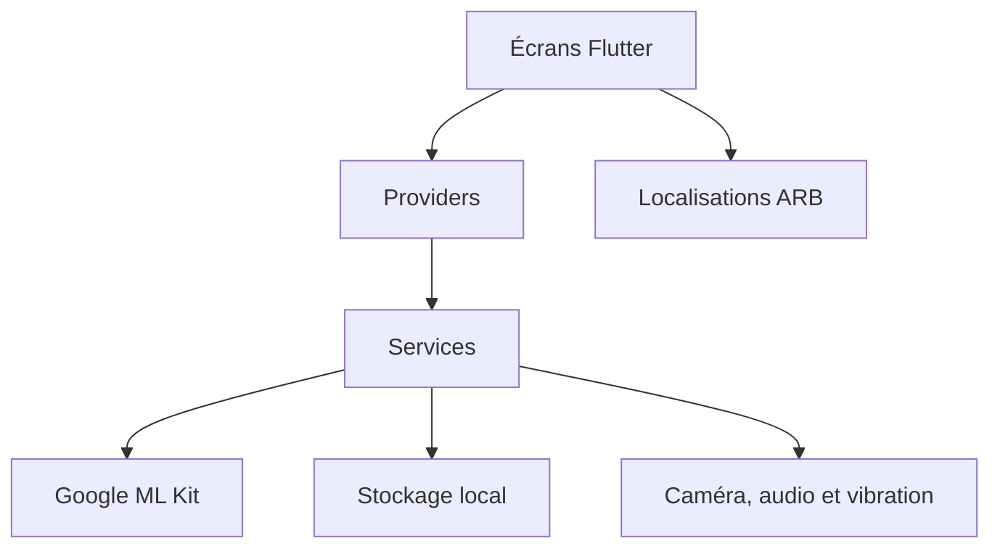

# SmartScan

> Assistant Flutter multilingue pour scanner du texte, identifier sa langue, le traduire hors ligne et le lire à voix haute.

[](https://flutter.dev/)
[](https://dart.dev/)
[](#licence)

## Sommaire

- [Présentation](#présentation)
- [Fonctionnalités](#fonctionnalités)
- [Stack technique](#stack-technique)
- [Architecture](#architecture)
- [Installation](#installation)
- [Exécution](#exécution)
- [Configuration](#configuration)
- [Qualité](#qualité)
- [Aperçu](#aperçu)
- [Roadmap](#roadmap)
- [Licence](#licence)

## Présentation

SmartScan est une application Flutter qui transforme une image contenant du texte en résultat exploitable. L’application combine OCR, détection de langue, traduction embarquée, synthèse vocale et historique local dans une interface disponible en français, anglais et arabe.

## Fonctionnalités

- Capture depuis la caméra ou sélection d’une image.
- Reconnaissance de texte avec Google ML Kit.
- Détection automatique de la langue.
- Traduction sur l’appareil vers plusieurs langues prises en charge.
- Lecture audio du texte original ou traduit.
- Historique local des scans et suppression sélective.
- Thème clair/sombre, vibration et préférences persistées.
- Interface localisée en français, anglais et arabe.

## Stack technique

| Domaine | Technologies |
| --- | --- |
| Interface | Flutter, Material 3 |
| Langage | Dart |
| État | Provider |
| OCR et NLP | Google ML Kit |
| Stockage local | SharedPreferences |
| Entrées multimédias | Camera, Image Picker |
| Audio et accessibilité | Flutter TTS, AudioPlayers, Vibration |
| Plateformes | Android, Web, Windows |

## Architecture



Le code applicatif est organisé par responsabilité :

```text
lib/
├── l10n/        # Ressources et classes de localisation générées
├── providers/   # État partagé de l’application
├── screens/     # Écrans et flux de navigation
├── services/    # OCR, traduction, stockage et retours multimédias
├── widgets/     # Composants d’interface réutilisables
├── main.dart    # Point d’entrée et composition de l’application
└── types.dart   # Types partagés
```

## Installation

Prérequis :

- Flutter stable compatible avec Dart `^3.10.7`.
- Android Studio et un SDK Android pour la cible Android.
- Un émulateur ou appareil compatible avec la caméra pour tester le scan.

```bash
git clone https://github.com/AichaAbdennadher/smartScan.git
cd smartScan
flutter pub get
```

## Exécution

```bash
flutter devices
flutter run
```

Vérifications locales :

```bash
flutter analyze
flutter test
```

## Configuration

Aucune clé API ni variable d’environnement n’est actuellement requise. Le fichier [`.env.example`](.env.example) documente cette situation et sert de point de départ pour de futures intégrations. Ne commitez jamais un fichier `.env` réel.

Les modèles de traduction Google ML Kit sont utilisés sur l’appareil et peuvent nécessiter un téléchargement initial selon la plateforme et la langue.

## Qualité

Chaque push et chaque pull request vers `main` déclenche automatiquement `flutter analyze` et `flutter test` via GitHub Actions.

## Aperçu


## Roadmap

- Ajouter des tests ciblés pour les providers et services.
- Ajouter des captures d’écran et une courte démonstration vidéo.
- Finaliser la signature Android et les métadonnées de publication.
- Renforcer la gestion des erreurs et des permissions par plateforme.
- Évaluer une stratégie de persistance plus robuste pour les historiques volumineux.

## Licence

Aucune licence open source n’est actuellement déclarée. Ajouter une licence avant toute redistribution publique.
